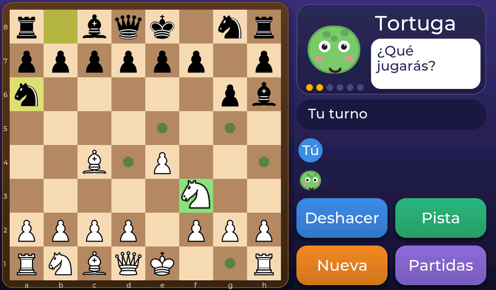
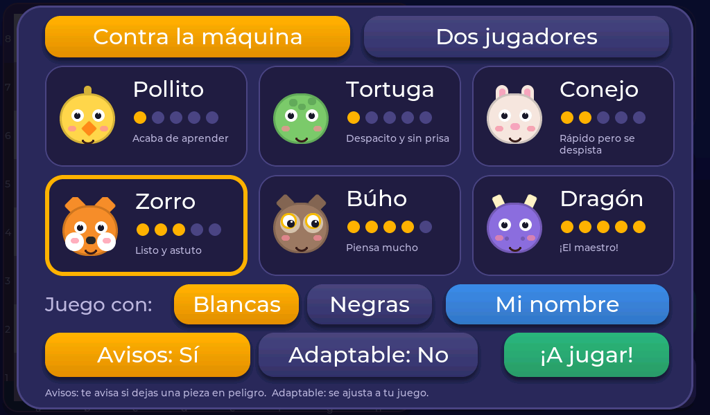

<p align="center">
  
</p>

<h1 align="center">Ajedrez de los animales</h1>

<p align="center">
  Ajedrez táctil para niños en la <strong>Guition JC1060P470</strong> (ESP32-P4, pantalla de 1024×600)
</p>

<p align="center">
  <strong>v0.1.0</strong> &nbsp;·&nbsp;
  <a href="https://reasol-edu.github.io/esp32-chess/">Manual</a> &nbsp;·&nbsp;
  <a href="CHANGELOG.md">Cambios</a> &nbsp;·&nbsp;
  <a href="LICENSE-engine-GPLv3">GPL v3</a>
</p>

<p align="center">
  
  
</p>

---

Un ajedrez que se juega **con el dedo**, pensado para que lo pasen bien los más peques. Funciona solo, sin móvil, sin cuenta y sin
conexión a internet. Usa **LVGL 9.6** con la unidad de dibujo **PPA** del ESP32-P4 y el motor de
[hpsaturn/esp32-chess-engine](https://github.com/hpsaturn/esp32-chess-engine).

<p align="center">
  
  
</p>

## Qué incluye

- **Seis animales como rivales**, de Pollito (casi al azar) a Dragón (el maestro). Los bajos «se despistan» a propósito.
- **Ayudas:** puntos en las casillas legales, *Pista*, *Deshacer* ilimitado, aviso de pieza en peligro y modo adaptable.
- **Dos jugadores** cara a cara (con la parte de las negras girada) o pasándose el aparato, con **reloj** opcional.
- **Nombres** opcionales con teclado en pantalla (con ñ y tildes), que solo se guardan en el propio aparato.
- **Guardar y cargar** partidas en 3 huecos.
- Muy visual: tablero de madera, piezas animadas, mascota que reacciona y confeti al ganar.

## Documentación

| Para… | Enlace |
|---|---|
| Niñas y niños: cómo se juega | [Manual](https://reasol-edu.github.io/esp32-chess/) |
| Familias y docentes: niveles, datos, uso en el aula | [Para familias y docentes](https://reasol-edu.github.io/esp32-chess/07-familias-y-docentes.html) |
| Quien monte o programe el aparato | [Anexo técnico](https://reasol-edu.github.io/esp32-chess/08-montaje.html) |
| Descargar el manual en PDF | [esp32-chess-manual.pdf](https://reasol-edu.github.io/esp32-chess/esp32-chess-manual.pdf) |

El manual está escrito en Markdown en [`docs/manual/`](docs/manual/). Una GitHub Action
([`docs.yml`](.github/workflows/docs.yml)) genera la web con MkDocs Material y el PDF con pandoc + Paged.js,
y publica la web en GitHub Pages. En local:

```bash
pip install -r docs/manual/requirements.txt
make docs          # PDF + web (necesita pandoc, Node.js y Chrome)
make docs-serve    # previsualización en http://127.0.0.1:8000
make screenshots   # regenera las capturas con el simulador del PC
```

## Compilar y grabar

PlatformIO no suele estar en el `PATH`: `~/.platformio/penv/bin/pio`.

```bash
pio run -e jc1060p470                         # compila (con PPA)
ESPTOOL=<venv>/bin/esptool tools/flash.sh     # graba la placa (hace falta esptool 5.3.dev3)
pio test -e native                            # 54 tests del motor y de la lógica de partida, en el PC
tools/sim/shot.sh mid                         # captura de la interfaz sin placa
```

Los detalles de la placa (rev v3.2, panel V2, por qué `pio upload` falla), la estructura del código y el motor
están en el [anexo técnico](docs/manual/08-montaje.md).

## Estado

Probado en la placa JC1060P470 (ESP32-P4 rev v3.2, panel V2): arranca, el PPA funciona (24 sprites con SRM en ~19 ms) y el táctil
responde. Los niveles se han ajustado con medidas reales. Pendiente: comparar rendimiento con y sin PPA, sonido y guardado automático.
Ver el [registro de cambios](CHANGELOG.md).

## Licencia

El motor es **GPL v3** (ver [`LICENSE-engine-GPLv3`](LICENSE-engine-GPLv3)), así que el firmware que lo incluye se distribuye también
bajo GPL v3. Los sprites de las piezas son *cburnett* (ver `assets/pieces/`).
