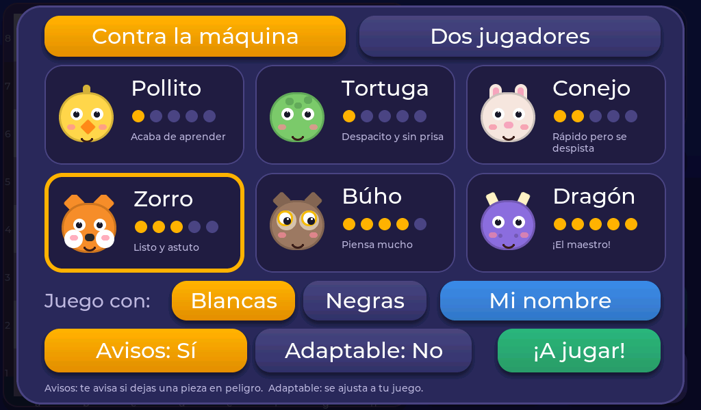
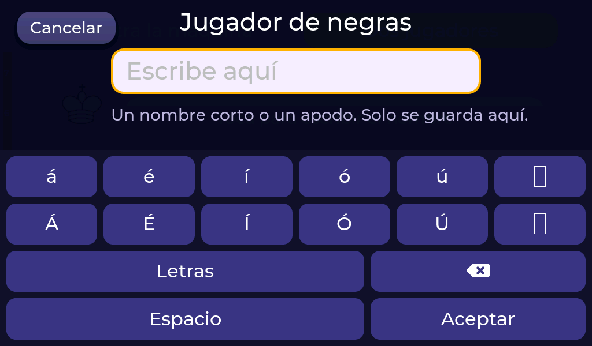
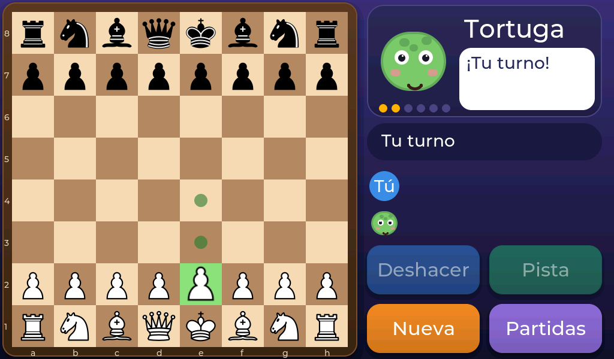
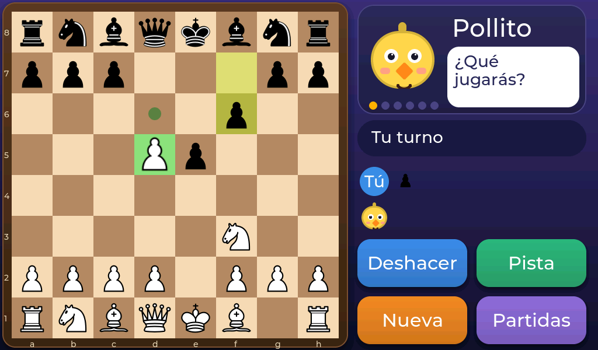
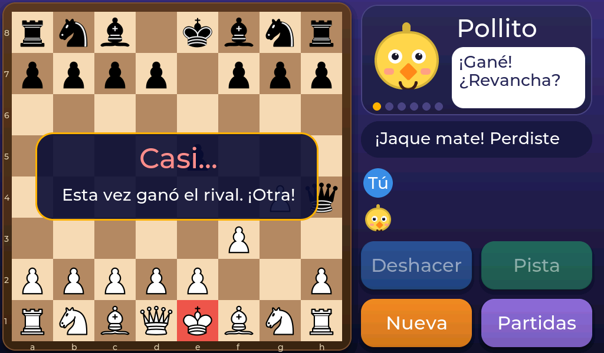
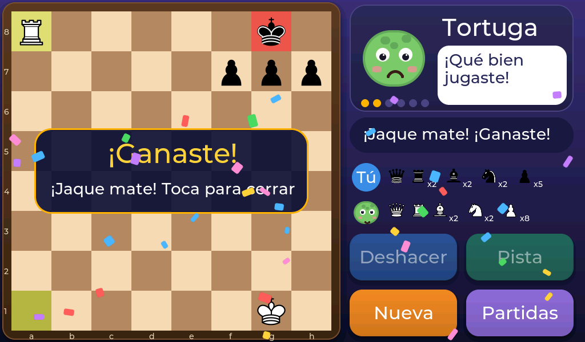

# Empezar a jugar

## 1. Elige a tu rival

Al encender el aparato aparece la pantalla de **nueva partida**. Arriba puedes elegir entre **Contra la máquina** y **Dos jugadores**. Vamos con la máquina.

Toca la tarjeta del animal contra el que quieres jugar. El que está elegido tiene el borde **amarillo**. Los puntitos amarillos te dicen lo fuerte que es: cuantos más, más difícil. Más detalles en [Elige tu animal](03-elige-tu-animal.md).

## 2. Elige tu color

Debajo de los animales, junto a «Juego con», elige **Blancas** o **Negras**. Las blancas siempre mueven primero.

También puedes tocar **Mi nombre** para escribir el tuyo (hasta 10 letras). Así la pantalla te llamará por tu nombre en vez de «Tú».

## 3. Los dos botones de ayuda

- **Avisos:** si lo dejas en *Sí*, el aparato te avisa cuando dejas una pieza en peligro.
- **Adaptable:** si lo activas, el animal se vuelve un poco más fácil o más difícil según cómo vayas jugando.

Los dos se explican en [Ayudas para aprender](04-ayudas.md).

## 4. ¡A jugar!

Toca **¡A jugar!** y empieza la partida.

## Cómo se mueve una pieza

1. **Toca la pieza** que quieres mover. Se ilumina de verde.
2. Aparecen **puntitos verdes** en las casillas a las que puede ir. En las casillas donde puede comer, el punto es un aro.
3. **Toca una casilla con punto** y la pieza se mueve.

Si te arrepientes antes del paso 3, toca otra vez la misma pieza o cualquier otra.

La mascota reacciona a lo que pasa: se alegra, se asusta o se sorprende. Debajo de ella ves a quién le **toca** y las **piezas que ya se han comido** unos a otros.

## Comer piezas

Para comer una pieza del rival, mueve la tuya a su casilla. Las piezas comidas salen del tablero y aparecen en la columna de la derecha.

## ¡Jaque!

Cuando una pieza amenaza al rey, la casilla del rey se pone **roja**. Eso es un **jaque**: hay que salvar al rey ya, moviéndolo, tapando el ataque o comiendo a quien lo amenaza.

## Ganar, perder y tablas

Si el rey no puede escapar, es **jaque mate** y se acaba la partida. Al ganar, ¡hay confeti!

Toca la pantalla para cerrar el cartel y, después, **Nueva** para otra partida.
