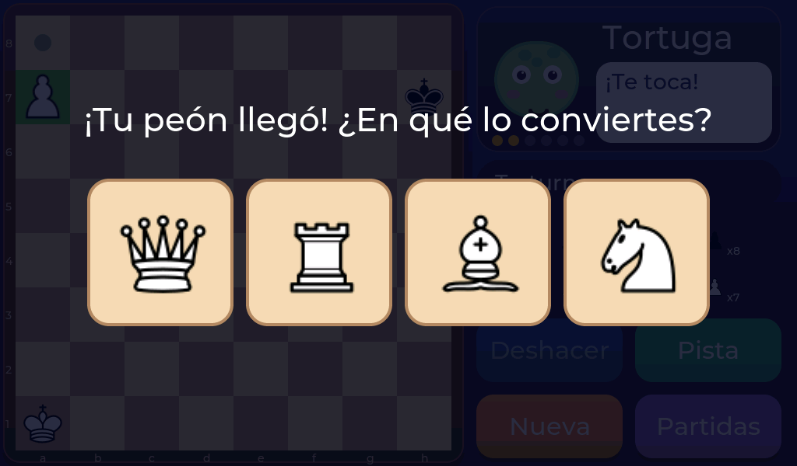

# Las piezas y cómo se mueven

Cada jugador empieza con 16 piezas. Todas se mueven de forma distinta, pero no te preocupes por aprenderlo de golpe: **al tocar una pieza, el aparato te enseña a dónde puede ir** con puntitos verdes.

| Pieza | Cómo se mueve |
|---|---|
| **Rey** | Una casilla en cualquier dirección. Es la pieza más importante: si lo pierdes, pierdes la partida. |
| **Dama** | Todas las casillas que quiera, en recta o en diagonal. La más poderosa. |
| **Torre** | En línea recta, hacia delante, atrás o a los lados. |
| **Alfil** | En diagonal. Siempre se queda en casillas del mismo color. |
| **Caballo** | Salta en forma de «L»: dos casillas rectas y una al lado. Es el único que puede saltar por encima de otras piezas. |
| **Peón** | Hacia delante, una casilla (dos la primera vez). Come en diagonal, un paso hacia delante. |

## Movimientos especiales

- **Enroque:** el rey se mueve dos casillas hacia una torre y la torre salta al otro lado. Sirve para poner al rey a salvo. Toca el rey y verás el punto de la casilla del enroque.
- **Coronación:** cuando un peón llega al otro lado del tablero se **convierte** en otra pieza. Aparece una ventana para que elijas cuál (normalmente la dama).
- **Comer al paso:** una jugada con peones un poco rara. Si el peón del rival avanza dos casillas y pasa a tu lado, puedes comerlo como si solo hubiera avanzado una.

## Tablas

A veces nadie gana: es un empate, se llaman **tablas**. El aparato las avisa en cuatro casos:

- **Rey ahogado:** al jugador que tiene el turno no le queda ninguna jugada y su rey **no** está en jaque.
- **Repetición:** la misma posición se repite tres veces.
- **50 jugadas:** pasan 50 jugadas sin comer ninguna pieza ni mover ningún peón.
- **Sin material:** quedan tan pocas piezas que ya nadie puede dar jaque mate.
