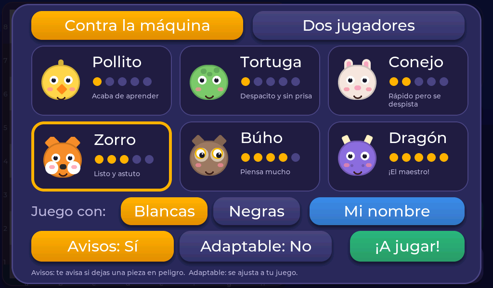

# Elige tu animal

Cada animal juega de una manera. Los puntitos amarillos de su tarjeta indican lo difícil que es.

| Animal | Puntos | Cómo juega |
|---|:---:|---|
| 🐥 **Pollito** | ●○○○○ | Acaba de aprender. Mueve casi sin pensar y se equivoca muchísimo. Ideal para las primeras partidas. |
| 🐢 **Tortuga** | ●○○○○ | «Despacito y sin prisa». Se equivoca bastante, pero ya no regala todas las piezas. |
| 🐰 **Conejo** | ●●○○○ | «Rápido pero se despista». Piensa un poco más, aunque de vez en cuando se despista. |
| 🦊 **Zorro** | ●●●○○ | «Listo y astuto». Casi no se despista; hay que tener cuidado. |
| 🦉 **Búho** | ●●●●○ | «Piensa mucho». Mira bastante por delante y no regala nada. |
| 🐉 **Dragón** | ●●●●● | «¡El maestro!». Es el más fuerte. Cuesta ganarle, ¡pero se puede! |

!!! tip "¿Por qué ganar al Pollito no vale tan poco?"
    Porque así se aprende. Empieza por el Pollito o la Tortuga, y cuando les ganes con facilidad, ¡prueba con el Conejo!

## El animal «se despista»

Los animales más sencillos **se despistan a propósito**: de vez en cuando hacen una jugada cualquiera en lugar de la mejor. Así no son perfectos, y puedes ganar aunque estés aprendiendo. Cuanto más fuerte es el animal, menos se despista. El Búho y el Dragón no se despistan nunca.

## ¿Cuánto tarda en pensar?

Los animales fáciles contestan casi al instante, pero para que no parezca que no piensan **esperan un momentito** antes de mover. Los fuertes piensan más rato: el Dragón puede tardar hasta 5 segundos. ¡Paciencia!
