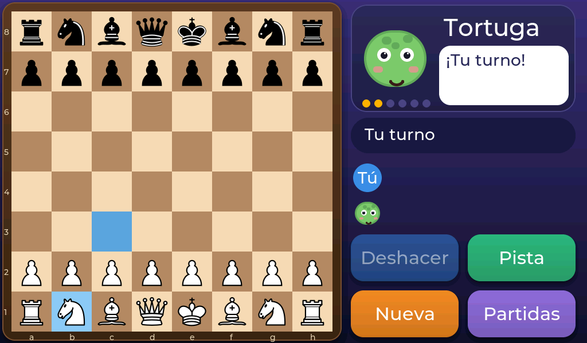
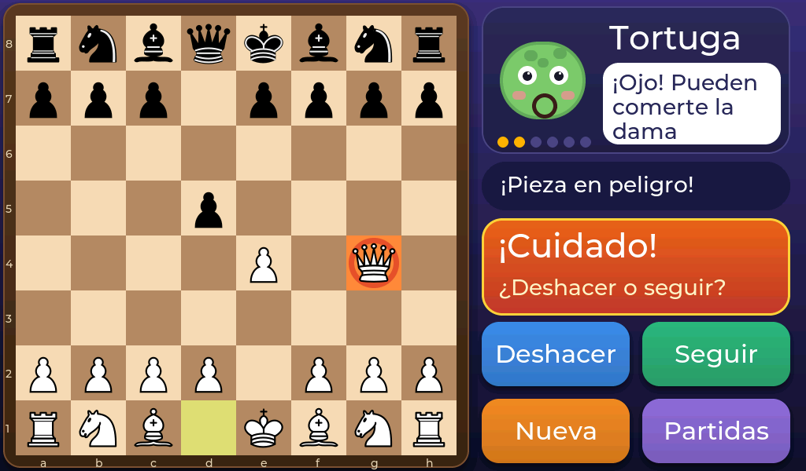
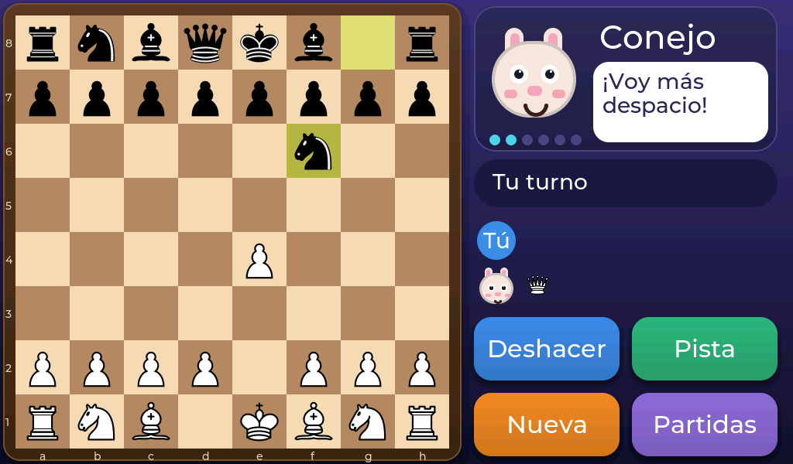

# Ayudas para aprender

Aprender ajedrez lleva tiempo. Estas ayudas están para que no te frustres.

## Pista

Toca **Pista** y el aparato te marca en **azul** la pieza que podrías mover y la casilla a la que llevarla. Tú decides si le haces caso.

## Deshacer

¿Te has equivocado? Toca **Deshacer** y se retira tu última jugada (y la del animal). Puedes deshacer **todas las veces que quieras**.

## ¡Cuidado! Pieza en peligro

Con **Avisos: Sí**, después de que el animal mueva, el aparato comprueba si puede **comerte una pieza importante gratis**. Si es así, la mascota se asusta, la pieza amenazada se marca de **naranja** y aparece un aviso:

- **Deshacer:** vuelves atrás y piensas otra jugada.
- **Seguir:** sigues adelante aunque corras el riesgo.

El juego solo avisa cuando de verdad vas a **perder material**: no te agobia por un peón suelto ni cuando se trata de un cambio igualado.

## Adaptable

Con **Adaptable: Sí**, el animal se ajusta a ti. Si vas ganando por mucho, juega mejor; si vas perdiendo, juega peor. Puede subir o bajar **hasta dos niveles** respecto al que elegiste. Los puntitos que hay bajo la mascota te muestran el nivel real: si es distinto del elegido, se ponen de color **cian**.

Para la siguiente partida, el animal empieza ya con el nivel al que había llegado.
