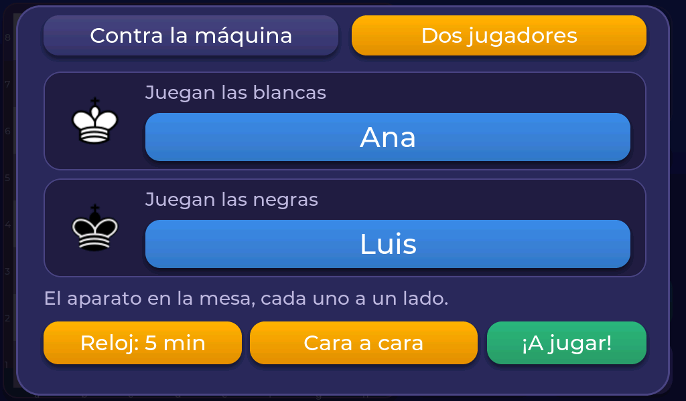
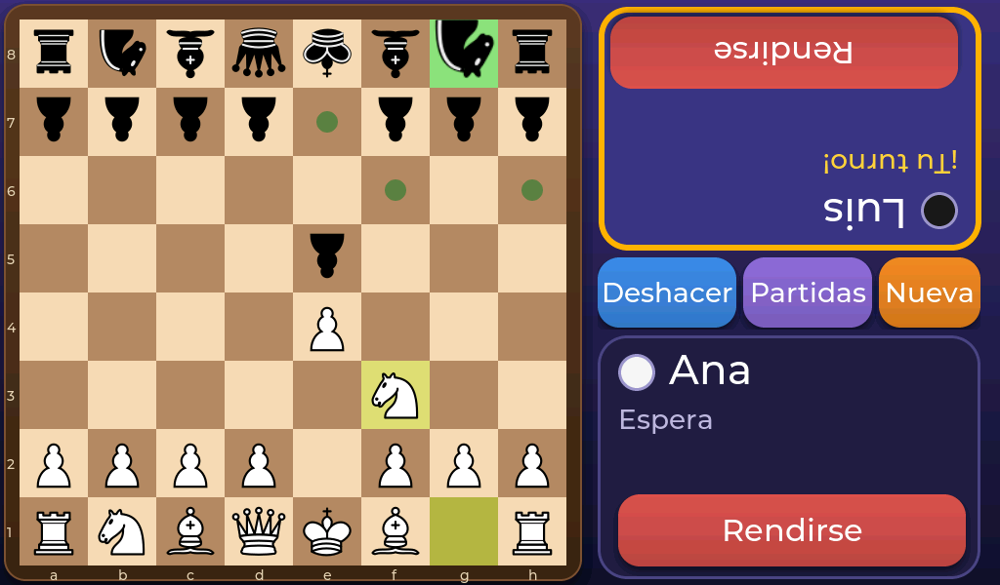
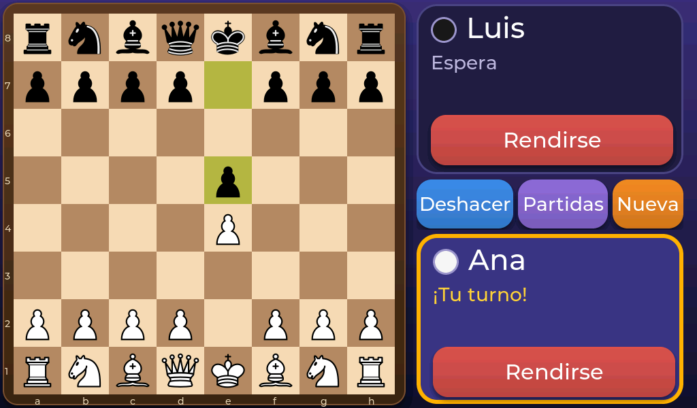
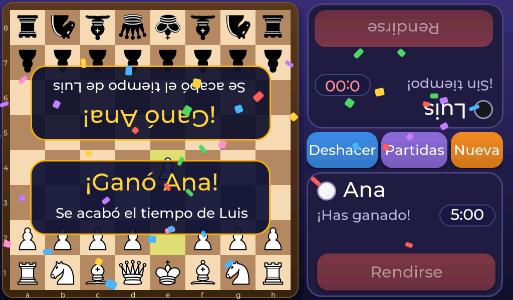
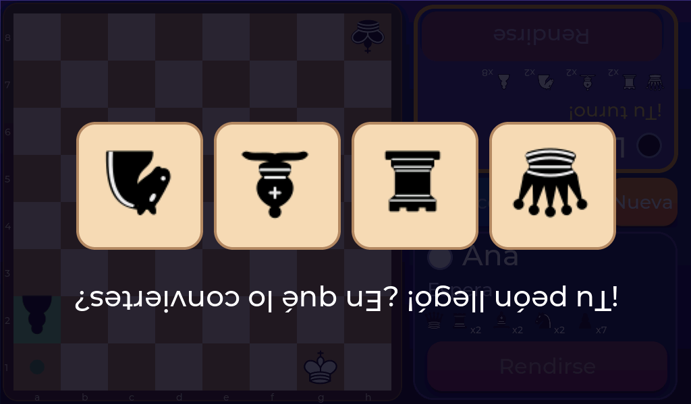

# Jugar con un amigo

Toca **Dos jugadores** en la pantalla de nueva partida. Los dos juegan en el mismo aparato, sin máquina.

## Los nombres

Toca el nombre de cada jugador para escribirlo (hasta 10 letras). Si no pones nombre, saldrá «Blancas» y «Negras».

## Dos formas de sentarse

El botón de al lado del reloj elige cómo os colocáis:

### Cara a cara

Dejáis el aparato **en medio de la mesa**, cada uno a un lado. Para el que juega con negras, todo sale **del revés** a su lado: su nombre, el botón de rendirse, los mensajes y hasta las piezas, así lo lee bien desde su sitio.

### Pasar el aparato

Los dos os sentáis **del mismo lado** y os pasáis la pantalla. Nada se gira: tablero, textos y piezas se ven siempre del mismo modo.

El modo elegido se recuerda al volver a encender.

## El reloj

Si queréis una partida con prisa, toca **Reloj** y elige 3, 5, 10 o 15 minutos por jugador (o «sin reloj»).

- El reloj de cada jugador solo corre en su turno.
- Empieza con la **primera jugada** de las blancas.
- Los últimos **20 segundos** se ponen en rojo.
- Si se acaba el tiempo, ese jugador **pierde** y aparece «Se acabó el tiempo de…».
- Si se abre cualquier ventana (guardar, nueva partida…), el reloj se **para**.

## Rendirse y deshacer

Cada jugador tiene su botón **Rendirse**. Para que nadie lo toque sin querer, pide una confirmación con un segundo toque. **Deshacer** retira la última jugada.

## Coronar

Cuando un peón llega al final, el que lo ha movido ve la ventana para elegir pieza, **del lado correcto** si estáis cara a cara.

