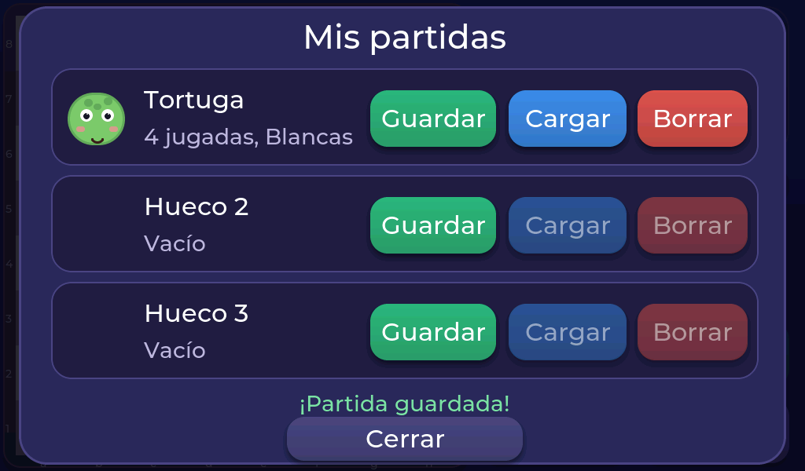
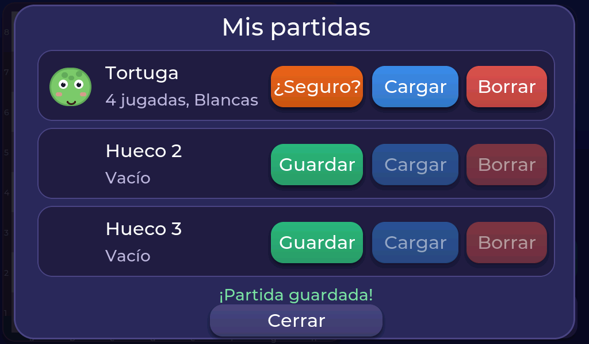

# Guardar tu partida

¿Te toca ir a comer y la partida no ha acabado? Toca **Partidas** y verás **tres huecos** donde guardar.

- **Guardar:** guarda la partida en ese hueco. Se ve cuántas jugadas lleva, con qué color juegas y el animal.
- **Cargar:** recupera una partida guardada.
- **Borrar:** vacía el hueco.

Si el hueco ya tenía una partida o hay una en curso, el aparato te pide **un segundo toque** para confirmar. Así no pierdes nada sin querer.

Al cargar una partida, esta se vuelve a jugar desde el principio hasta donde la dejaste, así que **Deshacer sigue funcionando** todas las veces que haga falta.

!!! note "Lo que no se guarda"
    El **reloj** no forma parte de la partida guardada: si cargas una partida de dos jugadores, el reloj empieza otra vez lleno.

!!! note "No hay guardado automático"
    Si apagas el aparato sin guardar, la partida en curso se pierde. Lo que sí se recuerda siempre es tu última elección (animal, color, nombres, avisos, reloj…).
