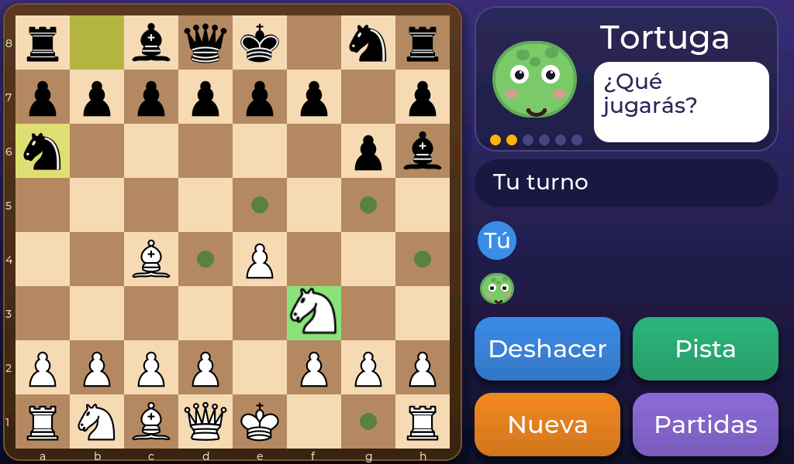

# ¡Bienvenido al ajedrez de los animales!

Este es un **ajedrez con pantalla táctil** hecho para que lo pasen bien los peques. Lo juegas con el dedo: tocas una pieza, tocas dónde quieres ponerla y listo. Nada de ratón ni de teclado.

## ¿Qué puedes hacer?

- **Jugar contra la máquina.** Elige entre seis animales: desde el Pollito, que acaba de aprender, hasta el Dragón, que es el maestro.
- **Jugar con un amigo** o con tu familia, con el aparato en medio de la mesa.
- **Pedir ayuda** cuando no sepas qué mover y **deshacer** si te equivocas.
- **Guardar tu partida** y seguir otro día.

## ¿Qué hay en este manual?

| Si quieres… | Mira |
|---|---|
| Empezar ya | [Empezar a jugar](01-empezar-a-jugar.md) |
| Repasar cómo se mueve cada pieza | [Las piezas](02-las-piezas.md) |
| Saber cómo juega cada animal | [Elige tu animal](03-elige-tu-animal.md) |
| Que te echen una mano | [Ayudas para aprender](04-ayudas.md) |
| Jugar con alguien más | [Jugar con un amigo](05-dos-jugadores.md) |
| Continuar otro día | [Guardar tu partida](06-guardar.md) |
| Ser madre, padre o docente | [Para familias y docentes](07-familias-y-docentes.md) |

!!! note "¿Eres una persona adulta?"
    Hay un capítulo pensado para ti: [Para familias y docentes](07-familias-y-docentes.md) explica cómo juega cada nivel, qué datos guarda el aparato (muy pocos, y solo dentro de él) y cómo usarlo en el aula. Si quieres montar o programar el aparato, mira el [anexo técnico](08-montaje.md).
